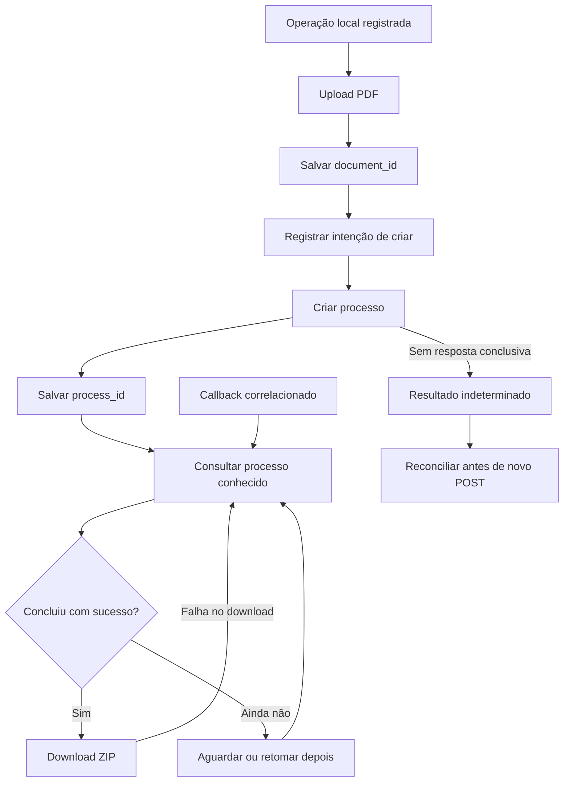

# Certillion Flow — Fluxos e recuperação

Documento público · Versão do kit: 0.6-beta. Aplicar junto da
[skill](certillion-flow-skill.md) e do [OpenAPI](certillion-flow-openapi.yaml).

## Processo simples

1. Autenticar a conta Flow e conservar a sessão/expiração no backend.
2. Preparar o PDF final e um receptor de callback público controlado.
3. Registrar uma operação local antes de enviar o arquivo; salvar o `document_id` recebido.
4. Registrar intenção de criação e salvar o `process_id` assim que a resposta permitir.
5. Os signatários concluem sua participação. Acompanhar o processo por ID, com
   intervalo e prazo local configuráveis; uma espera local encerrada não cancela o processo.
6. Em conclusão com sucesso, baixar o ZIP por ID. Salvar o arquivo e registrar o
   resultado sem apagar os IDs necessários à recuperação.

Os exemplos das cinco linguagens implementam operações independentes e checkpoints.
Eles fazem uma tentativa de login por invocação e uma retomada exclusivamente por
consulta/download. A aplicação pode renovar sessões conforme seu ciclo de vida,
sem reapresentar criação já aceita.



## Vários documentos e participantes

Cada PDF recebe um ID. Uploads independentes podem ser paralelos, salvando cada
resultado antes de continuar; não repetir os uploads já aceitos caso outro falhe.
Criar o processo somente quando todos os IDs desejados estiverem disponíveis.
Um único processo pode incluir vários PDFs e participantes, conforme a regra de
negócio. Não emitir um processo para cada consulta de estado ou tentativa de download.

Separar as operações locais de dois negócios distintos mesmo se os PDFs tiverem
conteúdo igual. Um ID de upload vinculado a um processo não pode ser reaproveitado
em outro. O paralelismo deve usar trava/coordenação por operação para evitar que
dois workers criem o mesmo processo.

## Preparação visual

Listar modelos e escolher ou cadastrar um modelo adequado. Exemplo de cadastro:

```json
{"name":"Modelo do integrador","model_type":"TEXT_ONLY","width":150,"height":75,"text_size":6,"text_alignment":"LEFT"}
```

Usar `signature_model.id` textual da resposta, após conversão numérica validada,
em `visual_signature.signature_model_id`. O objeto interno `SignatureModel` contém
a configuração retornada; não procurar campos diretamente ao lado de `id`.

Exemplo estrutural para um PDF e um signatário; os valores ilustrativos devem ser
substituídos pelos IDs retornados e pelo participante real da operação:

```json
{
  "title": "Contrato com apresentação visual",
  "type": "DIGITAL_SIGNATURE_VISIBLE",
  "documents": ["11111111-1111-4111-8111-111111111111"],
  "signers": [{"name":"Participante","email":"participante@example.invalid"}],
  "callback_url": "https://integracao.example.invalid/flow/callback",
  "visual_signature": {
    "signature_model_id": 123,
    "visual_signature_detail": [{
      "document_id": "11111111-1111-4111-8111-111111111111",
      "signer_email": "participante@example.invalid",
      "page_number": 1, "x_position": 40, "y_position": 50
    }]
  }
}
```

Este corpo mostra a associação dos dados, não garante posicionamento final. Página,
coordenadas, dimensões e rotação precisam ser compatíveis com o PDF. Um erro visual
não autoriza emitir um novo pedido automaticamente nem substituir a modalidade.

## Receptor de callback

Receber POST JSON com `process_id`/`status`, correlacionar com operação conhecida e
agendar consulta autenticada. O evento de conclusão pode informar
`FINALIZED_WITH_SUCCESS`; confirmar o estado consultado antes de disparar efeitos.
Preservar eventos desconhecidos para diagnóstico sem considerá-los sucesso.

A rotina de efeitos de negócio deve tolerar evento repetido e concorrência entre
callback e polling. O contrato não estabelece assinatura/autenticação de origem,
política de reentrega ou latência; alinhar esses pontos na implantação. A simples
correlação do ID não autentica o remetente.

Em desenvolvimento local, usar receptor público estável ou túnel HTTPS para o
coletor local. Um endereço temporário deixa de receber eventos depois que o túnel
encerra; consultas por ID continuam permitindo retomar o trabalho. Não substituir
silenciosamente o callback de um processo já criado.

## Recuperação por etapa

| Situação | Próxima ação |
|---|---|
| Upload aceito; criação ainda não enviada | Reutilizar o ID salvo para a mesma operação |
| Criação rejeitada por parâmetro com resposta conclusiva | Corrigir a causa e decidir nova tentativa dessa etapa; preservar uploads válidos conforme o vínculo informado |
| Timeout/5xx de criação sem ID | Marcar indeterminado; consultar informações disponíveis e reconciliar. Título/listagem não garantem unicidade |
| `process_id` recebido | Persistir e continuar por consulta; nunca repetir criação por falta de assinatura |
| Sessão expirou durante acompanhamento | Renovar autenticação e retomar o mesmo ID |
| HTTP403 no download | Conferir estado e repetir apenas leitura/download quando apropriado |
| Falha de disco após download | Baixar novamente pelo mesmo ID; não reassinar |
| Prazo local de espera esgotado | Salvar pendência e permitir retomada posterior pelo ID |

Não há chave de idempotência nem rota de cancelamento/revogação especificada. Se
não for possível resolver resultado indeterminado com as consultas disponíveis,
interromper automação de POST e levar diagnóstico redigido ao suporte.
